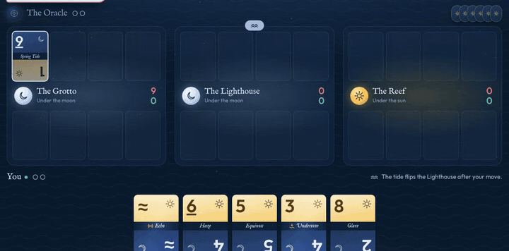
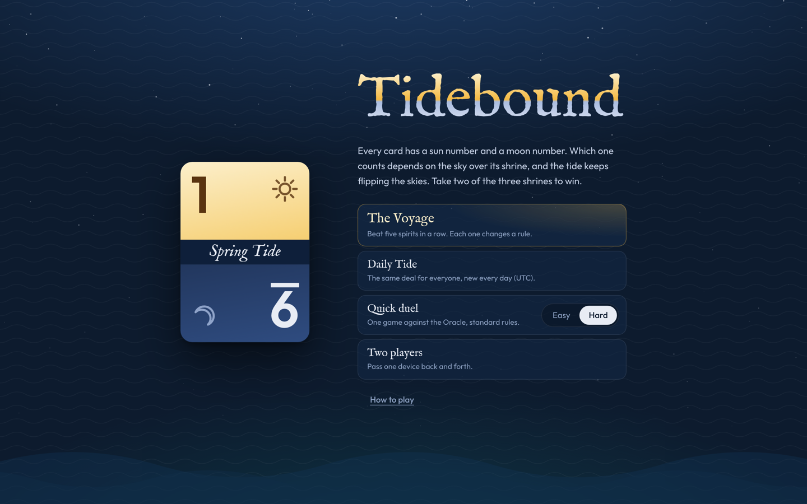
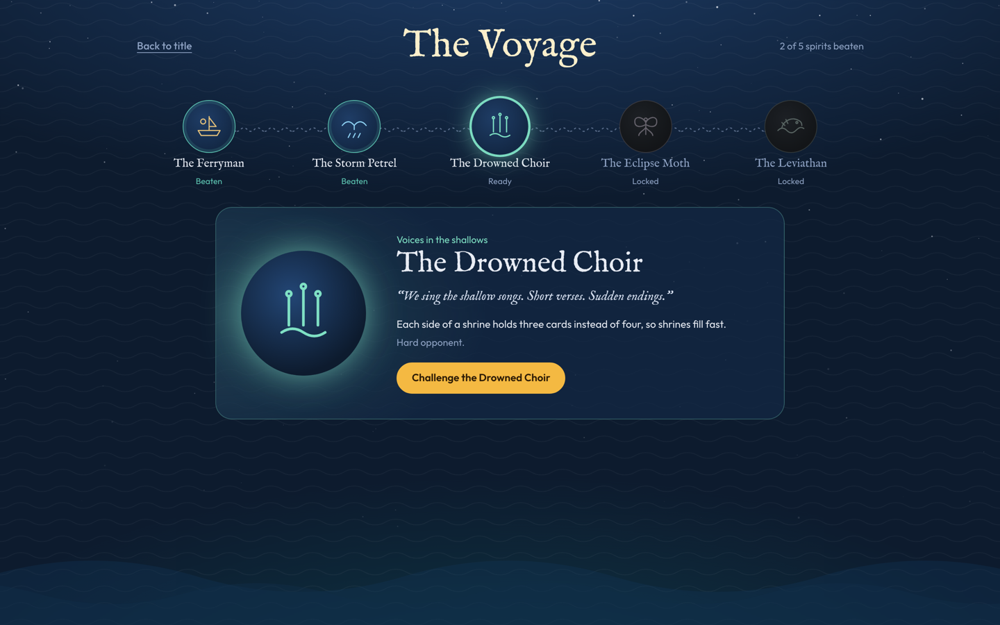
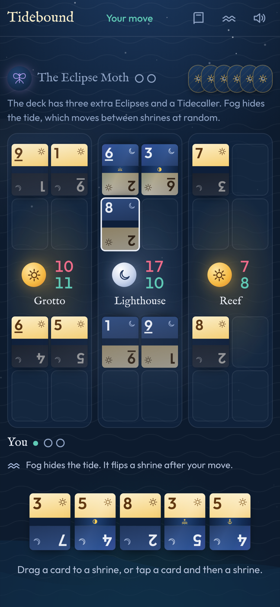
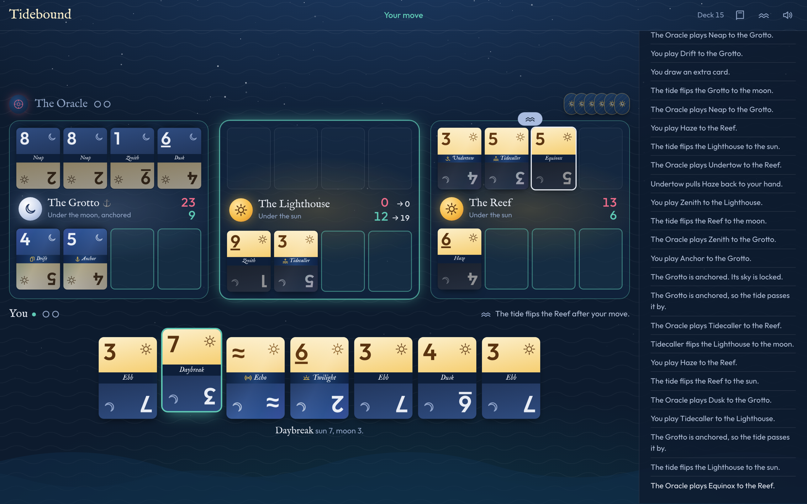

# Tidebound

[](https://github.com/isstiaung/tidebound/actions/workflows/ci.yml)
[](https://github.com/isstiaung/tidebound/actions/workflows/deploy.yml)
[](LICENSE)

**[Play it in your browser](https://tidebound.isstiaung.me/)**. No install or account needed. It works offline once loaded, and fits phones (portrait or landscape), tablets and desktops.

Every card has a **sun number** and a **moon number**. Which one counts depends on the sky over its shrine, and the tide keeps flipping the skies. Take two of the three shrines to win.

<p align="center">
  
</p>

## Ways to play

- **The Voyage.** Beat five spirits in a row. Each one changes a rule:
  - **The Ferryman:** no changes. A good place to learn.
  - **The Storm Petrel:** the tide flips a shrine after every move.
  - **The Drowned Choir:** each side of a shrine holds three cards instead of four.
  - **The Eclipse Moth:** extra Eclipses, and fog hides the tide, which moves at random.
  - **The Leviathan:** extra Undertows, and it holds one more card than you.

  Each spirit has its own personality, and your progress is saved.
- **Daily Tide.** The same deal for everyone, new every day (UTC), against the Oracle on Hard. Copy a spoiler-free result to share.
- **Quick duel.** One game against the Oracle, on Easy or Hard. Starting a new game while a duel is in progress counts that duel as a loss.
- **Two players.** Pass one device back and forth. Each hand stays hidden between turns.

| Title | The Voyage | On a phone |
| --- | --- | --- |
|  |  |  |

<p align="center">
  
</p>

## How to play

1. **Two numbers, one counts.** Every card has a sun number (top) and a moon number (bottom). In a shrine, only the number for that shrine's sky counts. Cards turn so that number is on top.
2. **Play one card a turn.** Drag it to your side of a shrine, or tap the card and then the shrine. Each side holds four cards. Then you draw.
3. **The tide flips skies.** After you and your opponent have both moved, the tide flips the sky of the shrine with the wave marker. Then the marker moves to the next shrine.
4. **Full shrines are decided.** When both sides of a shrine are full, its sky locks and the higher total takes the shrine. On a tie, whoever filled their side first takes it.
5. **Take two shrines to win.** If you each take one, the higher total across all three shrines wins.

A plain card's two numbers always add up to 10, so a card that's strong under the sun is weak under the moon. Special cards bend the rules:

| Card | What it does |
| --- | --- |
| Eclipse | Flips this shrine's sky. |
| Tidecaller | Makes the tide flip its next shrine right now. |
| Anchor | Locks this shrine's sky for the rest of the game. |
| Undertow | Returns your opponent's last card in this shrine to their hand (unless it's an Undertow). |
| Twilight | Always counts its higher number. |
| Lantern | Your other cards in this shrine get +1. |
| Echo | Counts the same as your opponent's best card in this shrine. |
| Drift | Draw an extra card. |

Whoever goes first gets an extra card, because going second is an advantage.

Keyboard: number keys pick a card from your hand, then Q, W or E plays it to the left, middle or right shrine. Esc cancels.

## Run it locally

```sh
npm install
npm run dev        # http://localhost:5173
```

## Test

```sh
npm test
```

The test suite covers:

- every rule and ability, including edge cases (undertow on the last open place, eclipse on the sealing card, forced seals after two passes, draws);
- fuzzed random games under every rule variant, checking that every card is always in exactly one place, no side overflows, sealed shrines never change, and every game ends;
- the AI only ever making legal moves, never peeking at your hand, the deck order or a fogged tide, and the Hard AI beating the Easy one;
- the Daily Tide seed, the share text, Voyage unlocking, spirit data, and storage that fails safely.

## Deploy

`npm run build` writes a fully static site to `dist/`, using relative asset paths, so it can be served from any host or sub-path:

- **GitHub Pages:** push to `main`. The included workflow (`.github/workflows/deploy.yml`) tests, builds and publishes. In the repo settings, set Pages → Source to "GitHub Actions".
- **Netlify / Vercel / Cloudflare Pages:** build command `npm run build`, output directory `dist`.
- **Anything else:** copy `dist/` to any static file server.

Once loaded, the game works offline (a service worker caches it) and can be installed as an app from the browser. Fonts are bundled locally, and sounds are synthesized, so it makes no network requests to third parties.

## Code layout

```
src/engine/cards.ts   the 40-card deck and ability text
src/engine/game.ts    pure, deterministic rules engine (seeded shuffles)
src/engine/ai.ts      the Oracle: heuristic evaluation + sampled 2-ply search
src/engine/ai.worker.ts  runs the AI off the main thread (ui/aiClient.ts falls back if workers fail)
src/ui/app.ts         game flow, rendering, drag and drop, staged animations
src/ui/spirits.ts     the Voyage's five spirits: rules, sigils and lines
src/ui/meta.ts        Daily Tide seeding, share text, Voyage progress (pure)
src/ui/fx.ts          starfield, particles, tide sweeps, card flights
src/ui/sound.ts       synthesized sound effects and ocean ambience
public/               icon, web manifest, service worker
```

## Contributing

Bug reports, balance ideas, new spirits and code are welcome. See [CONTRIBUTING.md](CONTRIBUTING.md).

## Credits

- Typefaces: [IM Fell English](https://fonts.google.com/specimen/IM+Fell+English) by Igino Marini and [Outfit](https://github.com/Outfitio/Outfit-Fonts) by the Outfit Project Authors, both under the [SIL Open Font License 1.1](https://openfontlicense.org), bundled via [Fontsource](https://fontsource.org).
- Everything else (cards, sigils, sounds and code) is original to this project.

## License

[MIT](LICENSE)
